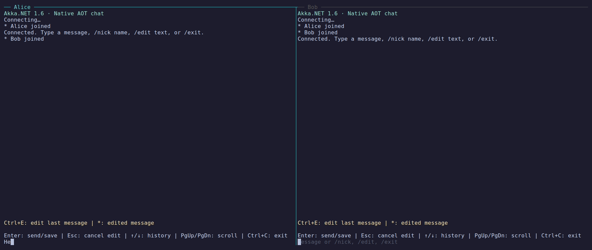

# Akka.NET 1.6 Native AOT chat

A small chat server with multiple [Termina](https://github.com/Aaronontheweb/termina) TUI clients. Both applications compile to native executables; running them requires no .NET installation.



[Replay or re-record the VHS demo](docs/demo/README.md).

## Run native clients

Publishing requires the .NET 10 SDK from `global.json`, PowerShell 7 (`pwsh` on your PATH), and the [Native AOT build prerequisites](https://learn.microsoft.com/dotnet/core/deploying/native-aot/#prerequisites).

The script streams compiler output and rejects additional AOT warnings.

### On Linux

```sh
./scripts/publish-native.ps1 -RuntimeIdentifier linux-x64
```

Start the server, then launch each client in its own terminal:

```sh
./artifacts/server/Demo.Server
```

```sh
./artifacts/client/Demo.Client Alice
```

```sh
./artifacts/client/Demo.Client Bob
```

### On Windows

Native AOT on Windows also needs Visual Studio 2022 with the **Desktop development with C++** workload.

```powershell
pwsh -File ./scripts/publish-native.ps1 -RuntimeIdentifier win-x64
```

Start the server, then launch each client in its own terminal:

```powershell
.\artifacts\server\Demo.Server.exe
```

```powershell
.\artifacts\client\Demo.Client.exe Alice
```

```powershell
.\artifacts\client\Demo.Client.exe Bob
```

On Apple Silicon, publish with `-RuntimeIdentifier osx-arm64` and run the same `./artifacts/...` commands as Linux.

Type a message and press Enter. Ctrl+E edits your last message: the input is prefilled, the message is highlighted yellow with a `>` marker, and a banner identifies the edit target. Enter saves; Esc cancels. Saved edits replace the original message and carry a `*` marker. `/edit text` is a shortcut for editing the last message.

`/nick name` changes your display name, including on your older retained messages in every connected client. Ctrl+C or `/exit` leaves and closes the client, including while editing. Up/Down recalls input; PageUp/PageDown scrolls the transcript. Each client gets a unique user ID and an ephemeral port, so multiple copies run together without configuration.

For development, use `dotnet run --project src/Demo.Server` and `dotnet run --project src/Demo.Client -- Alice`.

## Native executable sizes

Measured from the Release Native AOT executables in [CI run 40575366054](https://github.com/Aaronontheweb/akka.net-v1.6-demo/actions/runs/40575366054), commit `a936c04`, on October 27, 2026:

| Target | Server | Termina client |
| --- | ---: | ---: |
| Linux x64 | 12.44 MiB (13,043,632 bytes) | 12.89 MiB (13,514,896 bytes) |
| Windows x64 | 14.08 MiB (14,764,544 bytes) | 14.59 MiB (15,296,512 bytes) |
| Apple Silicon ARM64 | 12.08 MiB (12,667,192 bytes) | 12.52 MiB (13,131,752 bytes) |

These are executable sizes, excluding separate `.dbg`, `.pdb`, and `.dSYM` debug symbols and archive compression. One MiB is 1,048,576 bytes. Sizes vary with the SDK, target, and code changes.

After publishing, capture a fresh size report (use the runtime identifier you published):

```powershell
pwsh -File ./scripts/measure-native.ps1 -RuntimeIdentifier linux-x64
```

The report is written to `artifacts/native-sizes.md`. CI captures it for every target and includes it in the workflow summary and native application artifacts.

## Code

- `Demo.Core`: the existing commands, events, value types, source-generated serializer, and shared Artery configuration.
- `Demo.Server`: one actor tracks users and message ownership, validates commands, and broadcasts events.
- `Demo.Client`: `ChatUserActor` handles the connection and forwards server events through a local channel. The ViewModel applies those events to its `ChatClientState`, which owns the last 200 transcript entries, display names, and editing state. It sends existing protocol commands back through the actor. The page owns layout and input; state updates run on Termina's UI dispatcher.

The wire protocol is unchanged: `JoinChat`, `ChangeUserName`, `LeaveChat`, `SendMessage`, `EditMessage`, their existing events, and `ChatResponse`. Joining sends the newcomer existing users' `JoinedChat` events. Successful and rejected commands return `ChatResponse` with `OriginalCommand`. The server watches client actors to remove disconnected users. There is no persistence, message history replay, or automatic reconnect.

## Test

```sh
dotnet test -c Release

# After native publishing; Python 3; on Windows first run: python -m pip install pywinpty==3.1.0
python3 scripts/smoke-chat.py
```

The Akka.Hosting.TestKit suite covers every protocol message and every polymorphic response member; records and readonly record structs; GUIDs; Unicode and long strings; empty/default IDs; enums, including unknown values; nullable fields; actor references; unknown fields and missing optional fields; malformed payloads; and Hosting serializer registration with reflection-based loading disabled. A second actor system verifies every message and response union member over an actual Artery TCP connection. Actor tests cover chat behavior, ownership validation, channel delivery, and shutdown. Client state tests cover input translation, transcript updates, renaming, and editing.

The native smoke test starts the server and real TUI clients in pseudo-terminals on each supported platform. It verifies joining, chat, relabeling older messages after a rename, in-place edits, edit highlighting and cancellation, single-press Ctrl+C in normal chat and edit mode, `/exit`, and DeathWatch cleanup after a client crashes. CI runs it with both default and raw terminal input. Server errors fail the test.

## Native AOT details

This demo uses **experimental Artery TCP remoting**, bound to loopback on port 8081. Classic DotNetty remoting is not supported under Native AOT. Both apps set `PublishAot`; Akka's NuGet build targets disable `Akka.DynamicTypeLoading` for native publishing. Application serialization uses the generated MessagePack serializer registered by `WithChatSerializer`.

Akka.NET 1.6.0-beta4 still loads the DeathWatch failure detector by name. `ChatRemoting` preserves only `PhiAccrualFailureDetector`'s public constructors using `DynamicDependency`, so remote watches work after trimming. The remaining known dependency warning locations are recorded in `scripts/aot-warnings.txt`: classic transport/adapters, remote deployment, protobuf activation, exception deserialization, and the failure detector loader. They remain visible during publishing; `publish-native.ps1` rejects additional warning locations. The demo does not use remote deployment or custom transports/serializers.

CI builds and tests on Linux and Windows. A separate AOT job matrix publishes and launches the server and TUI clients on Windows x64, Linux x64, and Apple Silicon (macOS ARM64). Every target runs the same native multi-client smoke test, including crash cleanup. Windows uses ConPTY through `pywinpty`; Linux and macOS use POSIX pseudo-terminals. Native binaries and smoke logs are uploaded as workflow artifacts.
